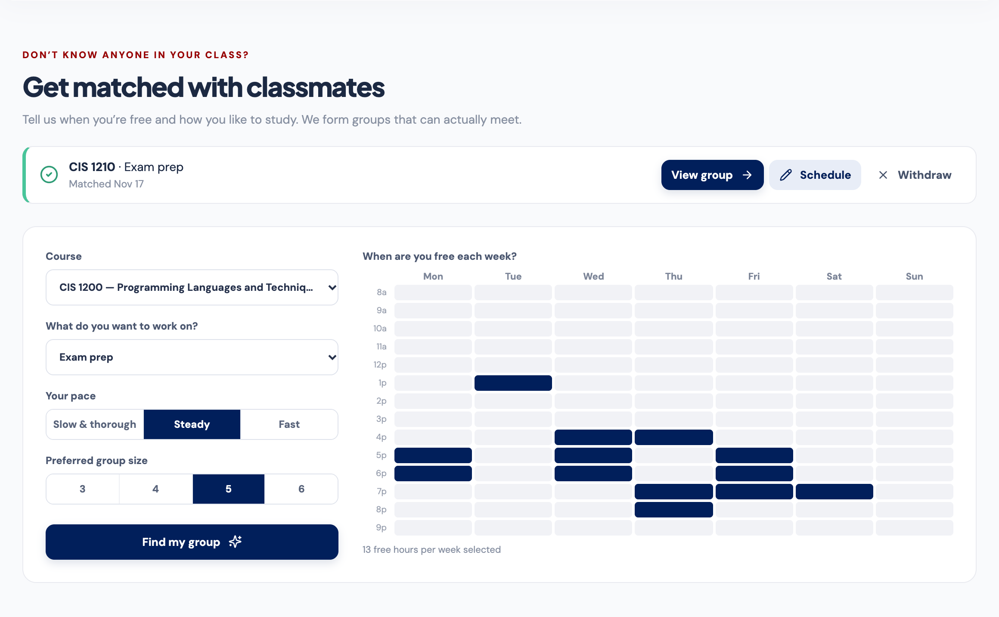
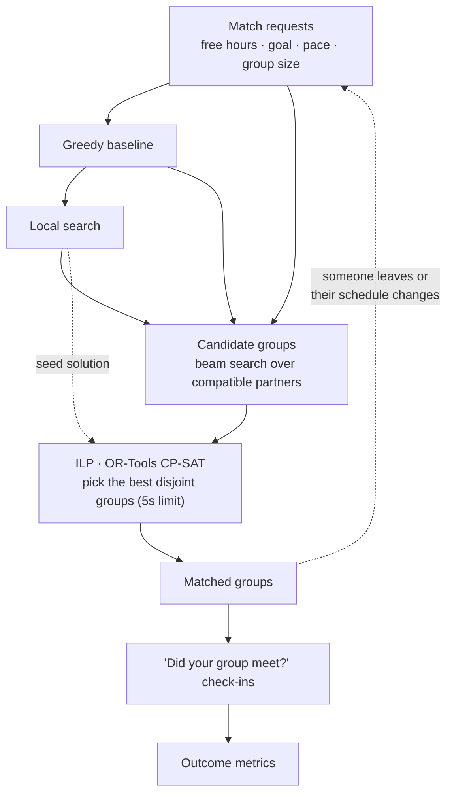

# CampusConnect

[](https://github.com/jessicalanggg/campusconnect/actions/workflows/ci.yml)

**Live:** [campusconnect-o57p.onrender.com](https://campusconnect-o57p.onrender.com) (sign-up with a Penn email)

**Study groups for students who don't know anyone in the class.** GroupMe and Discord work when you already have friends in a course. CampusConnect matches **strangers**: tell it when you're free, what you want to work on and how fast you like to go. In the two weeks before each exam it forms groups that can actually meet, then tracks whether they did.

React/TypeScript · FastAPI · PostgreSQL · OR-Tools (CP-SAT) · Docker · GitHub Actions

<p>
  
  
</p>

## Results

Every matching round runs three algorithms on the same students and logs all three. On synthetic populations ([full benchmark](docs/benchmark.md), 5 random populations per size):

| Students | Algorithm | Placed | Avg match quality | Shared free hours / week |
|---:|---|---:|---:|---:|
| 250 | Greedy baseline | 97.9% | 0.561 | 2.05 |
| 250 | Local search | 98.5% | 0.623 | 2.24 |
| 250 | **ILP (OR-Tools CP-SAT)** | **99.2%** | **0.674** (+20%) | **2.53** (+23%) |
| 500 | Greedy baseline | 98.8% | 0.563 | 2.06 |
| 500 | Local search | 99.0% | 0.653 | 2.36 |
| 500 | **ILP (OR-Tools CP-SAT)** | **99.0%** | **0.665** (+18%) | **2.43** (+18%) |

At 500 students, CP-SAT reaches its 5-second limit before it finishes improving, so local search closes much of the gap. A longer limit (`ILP_TIME_LIMIT_SECONDS`) helps very large courses.

In small classes the main win is placement: with 30 students the ILP places **75%** of them versus **45%** for greedy, because it can choose whole groups that greedy's one-at-a-time choices rule out.

## Real-world results

_The app is [live](https://campusconnect-o57p.onrender.com). Results will go here after the first exam round, with the date range and the method behind each number._

The app tracks outcomes, not signups (`/api/metrics`, **Impact** tab):
- the share of matched groups that met at least once and at least twice, from members' check-ins
- retention across exams and courses
- median and p90 time to match

How results are recorded:
- `python -m app.results --out ../docs/results` saves a dated, aggregate-only snapshot after each exam round.
- `python -m app.matching.real_benchmark` reruns the greedy/ILP comparison on real request pools, anonymized to free hours, goal, pace and group size. That's what backs any "on real data" claim. The table above is synthetic.

## How matching works



Group formation is a **constrained assignment problem**:
- **Constraints:** groups of 3–6 students, and every member free during at least 2 common hours a week. Otherwise the group can't meet.
- **Quality score:** shared free time (40%), same study goal (25%), similar pace (15%), and closeness to each student's preferred group size (20%).

Shared time uses the **true group-wide overlap**, the hours when *everyone* is free. Three people can each overlap pairwise and still never all be free at once, so the ILP chooses whole groups rather than pairs. It starts from the local-search solution, so its result is never worse than either baseline.

**Lifecycle:**
- **Exam-aware rounds:** groups form automatically in the 14 days before each exam. Outside those windows, nobody waits more than about 24 hours.
- **Instant placement:** late sign-ups who fit go straight into an open seat.
- **Automatic rematching:** students are rematched when someone leaves or their schedule changes.

Design details: [docs/matching.md](docs/matching.md).

## Features

**Matching**
- Weekly availability grid (drag to paint), study goal, pace, preferred group size
- Exam-aware rounds, instant placement, rematching on leave or schedule change
- Greedy vs local search vs ILP on every round, recorded in `match_runs`
- "Did your group meet?" check-ins and an **Impact** page with outcome metrics
- Admin tools: add exam dates and run a matching round on demand

**Accounts and security**
- Configurable sign-up: open to any email by default, or restricted to school domains (e.g. `upenn.edu`, including subdomains) with an emailed confirmation link before first sign-in
- Sessions in HttpOnly, SameSite cookies, with double-submit CSRF tokens on writes
- Rate limits on sign-up, sign-in, verification emails and write endpoints. They're per account where it matters, so a whole lecture hall behind one campus IP isn't blocked.

**Open groups**
- Create, search, filter and join student-run groups
- First-come, first-served waitlists for full groups, promoted under PostgreSQL row locks
- Owner-only edit and delete; capacity enforced under concurrent joins

**Engineering**
- FastAPI, SQLAlchemy and Alembic migrations; React and TypeScript with Vite
- Argon2 password hashing; signed, purpose-scoped tokens for sessions and email verification
- Pytest and Vitest suites in GitHub Actions CI; Docker Compose for local development
- One production image (React app served by FastAPI) and a Render blueprint ([deploy guide](docs/deploy.md))

## Quick start (Docker)

Prerequisites: Docker Desktop with Compose.

```bash
cp .env.example .env
# Edit .env: set SECRET_KEY to a long random value and ADMIN_EMAILS to your email.
docker compose up --build
```

Open **http://localhost:5173** for the app, **http://localhost:8000/docs** for the interactive API docs, and **http://localhost:8000/health** for a health check.
- Migrations and course seeding run automatically. A fresh install starts with courses only, so register an account to begin.
- Sign-up is open to any email by default. To limit it to a school and require email confirmation, set `ALLOWED_EMAIL_DOMAINS=upenn.edu` and `REQUIRE_EMAIL_VERIFICATION=true`. Without SMTP settings, confirmation links are printed in the backend log (`docker compose logs backend`).
- Compose also starts a `matcher` service that runs exam-aware matching every hour.

Stop with `docker compose down`. To delete local database data: `docker compose down -v` (destructive).

## Local development without Docker

Start PostgreSQL and set `DATABASE_URL` to a `postgresql+psycopg://...` URL, or use SQLite for prototyping. In `backend/`:

```bash
python -m venv .venv
source .venv/bin/activate   # Windows PowerShell: .venv\Scripts\Activate.ps1
pip install -r requirements-dev.txt
export DATABASE_URL=sqlite:///./campusconnect.db   # PowerShell: $env:DATABASE_URL='sqlite:///./campusconnect.db'
export SECRET_KEY=replace-this-with-a-long-random-secret
alembic upgrade head
python seed.py
uvicorn app.main:app --reload
# optional, in another terminal: background matcher (or one pass with --once)
python -m app.matching.scheduler
```

In another terminal, run `cd frontend && npm install && npm run dev`.

Outside Docker, Vite can't reach the proxy host `backend`. Either set `VITE_API_URL=http://localhost:8000` in `frontend/.env.local`, or change the proxy target in `frontend/vite.config.ts`.

## Tests

```bash
cd backend && pip install -r requirements-dev.txt && pytest -q && ruff check app tests seed.py
cd frontend && npm install && npm run test && npm run lint && npm run build
python -m app.matching.benchmark --out ../docs/benchmark.md   # from backend/: regenerate the benchmark
```

## Deploying

See [docs/deploy.md](docs/deploy.md). In short: Render → New → Blueprint → this repo, then fill in your URL and admin email. Before real students use it, upgrade the free database, which expires after 30 days.

## Limitations

- **Password reset** isn't built yet.
- **Rate limits** are kept in memory, so they're per instance. That's fine for one instance; use Redis to scale out.
- **Data entry:** students enter availability by hand. Calendar import is a natural next step.

More docs: [matching design](docs/matching.md) · [benchmark](docs/benchmark.md) · [deploy](docs/deploy.md) · [architecture](docs/architecture.md) · [ER schema](docs/schema.md) · [API](docs/api.md)
