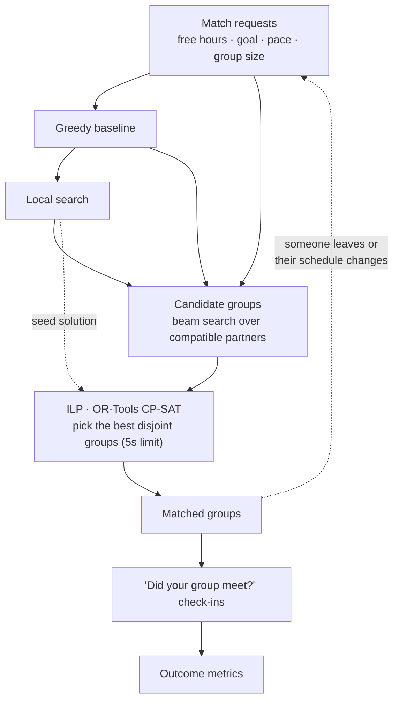

# CampusConnect

[](https://github.com/jessicalanggg/campusconnect/actions/workflows/ci.yml)

**Live:** [campusconnect-o57p.onrender.com](https://campusconnect-o57p.onrender.com) (sign-up with a Penn email)

**Study groups for students who don't know anyone in the class.** GroupMe and Discord work when you already have friends in a course. CampusConnect matches **strangers**: tell it when you're free, what you want to work on and how fast you like to go. In the two weeks before each exam it forms groups that can actually meet, then tracks whether they did.

React/TypeScript · FastAPI · PostgreSQL · OR-Tools (CP-SAT) · Docker · GitHub Actions


https://github.com/user-attachments/assets/e0bf2a06-f6f9-4fca-8de1-086a0ade8abc


<sub>Demo with simulated classmates on a local copy of the app (45 seconds).</sub>

## Results

CampusConnect's matcher is benchmarked against simpler strategies on the same simulated students, with paired trials and 95% confidence intervals.

**Real Penn class schedules** ([report](docs/benchmark_penn.md)). Each simulated student's busy hours come from actual Fall 2026 section meeting times for CIS 1200, MATH 1400, ECON 0100 and PHYS 0150 (250-student pools, 200 paired trials):

| Strategy | Placed | Avg match quality | Shared free hours / week |
|---|---:|---:|---:|
| Sign-up sheet (first come) | 94.1% | 0.540 | 2.04 |
| Greedy baseline | 99.6% | 0.557 | 2.06 |
| Local search | 99.8% | 0.677 | 2.49 |
| **ILP (OR-Tools CP-SAT)** | **99.9%** | **0.753** (+35.2% vs greedy, 95% CI +34.3 to +36.1) | **2.98** (+44.5%) |

**Synthetic populations** ([report](docs/benchmark.md)):
- **250 students** (100 trials): +25.3% match quality over greedy (95% CI +24.6 to +26.0) and +28.3% over a sign-up sheet. The ILP beat greedy in all 100 trials.
- **Large classes:** above 300 students the class is split into clusters with similar free time. At 500 students this adds +5.0% quality over a single ILP (95% CI +3.6 to +6.4).
- **Harder populations:** gains hold for busy students with little free time (+12.5%) and for widely mixed preferences (+29.3%).

**Load test** ([report](docs/loadtest.md)): 500 simulated students and 2,795 requests against the real API (4 workers) and PostgreSQL. That covered simultaneous sign-ups and requests, matching rounds under load, leaving, rescheduling and withdrawing, and 166 students racing for 3 last seats. After every phase the database showed 0 overfilled groups, 0 double placements and 0 mismatched memberships, with 0 server errors and 0 deadlocks.

All of these are algorithm and system tests on simulated students, not usage results.

The [live app](https://campusconnect-o57p.onrender.com) tracks outcomes through `/api/metrics`:
- the share of matched groups that met at least once and at least twice, from members' check-ins
- retention across exams and courses
- median and p90 time to match

Results are recorded and evaluated using:
- `python -m app.results --out ../docs/results` to save dated, aggregate-only snapshots after each exam round.
- `python -m app.matching.real_benchmark` to compare greedy and ILP matching on anonymized live request pools (free hours, goal, pace, and group size).

## How matching works



Group formation is a **constrained assignment problem**:
- **Constraints:** groups of 3–6 students, and every member free during at least 2 common hours a week. Otherwise the group can't meet.
- **Quality score:** shared free time (40%), same study goal (25%), similar pace (15%), and closeness to each student's preferred group size (20%).

Shared time uses the **true group-wide overlap**, the hours when *everyone* is free. Three people can each overlap pairwise and still never all be free at once, so the ILP chooses whole groups rather than pairs. It starts from the local-search solution, so its result is never worse than either baseline.

**Lifecycle:**
- **Exam-aware rounds:** groups form automatically in the 14 days before each exam. Outside those windows, nobody waits more than about 24 hours.
- **Instant placement:** late sign-ups who fit go straight into an open seat.
- **Automatic rematching:** students are rematched when someone leaves or their schedule changes.

Design details: [docs/matching.md](docs/matching.md).

## Features

**Matching**
- Weekly availability grid (drag to paint, quick presets), study goal, pace, preferred group size
- An anonymous heatmap on the grid shows when waiting classmates are free (counts only, hidden for pools under 3)
- While waiting: how many classmates are in the pool, how many share enough free time with you, and when the next round runs
- Once matched: members' emails and optional contacts (Discord, phone), "Email the group", a suggested first meeting, and an `.ics` calendar file that repeats the shared hours until the exam
- Exam-aware rounds, instant placement, rematching on leave or schedule change
- Greedy vs local search vs ILP on every round, recorded in `match_runs`
- "You're matched" emails to verified students, sent after the placement commits (Resend over HTTPS, or SMTP)
- "Did your group meet?" check-ins and outcome metrics (`/api/metrics`)
- Admin tab (admins only): add exam dates, run a matching round on demand, see past rounds

**Accounts and security**
- Configurable sign-up: open to any email by default, or restricted to school domains (e.g. `upenn.edu`, including subdomains) with an emailed confirmation link before first sign-in
- Sessions in HttpOnly, SameSite cookies, with double-submit CSRF tokens on writes
- Rate limits on sign-up, sign-in, verification emails and write endpoints. They're per account where it matters, so a whole lecture hall behind one campus IP isn't blocked.

**Concurrency**
- Group capacity enforced under concurrent matching: placing a student locks their request row and the group row (`SELECT … FOR UPDATE`) and re-checks capacity, so a group is never overfilled and a student is never placed twice
- Open seats go to the longest-waiting compatible student first
- Per-course PostgreSQL advisory locks keep the hourly matcher and live requests from interleaving
- Verified by concurrency tests that race simultaneous placements against a real PostgreSQL in CI

**Engineering**
- FastAPI, SQLAlchemy and Alembic migrations; React and TypeScript with Vite
- Argon2 password hashing; signed, purpose-scoped tokens for sessions and email verification
- Pytest and Vitest suites in GitHub Actions CI (with a PostgreSQL service for the concurrency tests); Docker Compose for local development
- One production image (React app served by FastAPI) and a Render blueprint ([deploy guide](docs/deploy.md))

## Quick start (Docker)

Prerequisites: Docker Desktop with Compose.

```bash
cp .env.example .env
# Edit .env: set SECRET_KEY to a long random value and ADMIN_EMAILS to your email.
docker compose up --build
```

Open **http://localhost:5173** for the app, **http://localhost:8000/docs** for the interactive API docs, and **http://localhost:8000/health** for a health check.
- Migrations and course seeding run automatically. A fresh install starts with courses only, so register an account to begin.
- Sign-up is open to any email by default. To limit it to a school and require email confirmation, set `ALLOWED_EMAIL_DOMAINS=upenn.edu` and `REQUIRE_EMAIL_VERIFICATION=true`. Without SMTP settings, confirmation links are printed in the backend log (`docker compose logs backend`).
- Compose also starts a `matcher` service that runs exam-aware matching every hour.

Stop with `docker compose down`. To delete local database data: `docker compose down -v` (destructive).

## Local development without Docker

Start PostgreSQL and set `DATABASE_URL` to a `postgresql+psycopg://...` URL, or use SQLite for prototyping. In `backend/`:

```bash
python -m venv .venv
source .venv/bin/activate   # Windows PowerShell: .venv\Scripts\Activate.ps1
pip install -r requirements-dev.txt
export DATABASE_URL=sqlite:///./campusconnect.db   # PowerShell: $env:DATABASE_URL='sqlite:///./campusconnect.db'
export SECRET_KEY=replace-this-with-a-long-random-secret
alembic upgrade head
python seed.py
uvicorn app.main:app --reload
# optional, in another terminal: background matcher (or one pass with --once)
python -m app.matching.scheduler
```

In another terminal, run `cd frontend && npm install && npm run dev`.

Outside Docker, Vite can't reach the proxy host `backend`. Either set `VITE_API_URL=http://localhost:8000` in `frontend/.env.local`, or change the proxy target in `frontend/vite.config.ts`.

## Tests

```bash
cd backend && pip install -r requirements-dev.txt && pytest -q && ruff check app tests seed.py loadtest
cd frontend && npm install && npm run test && npm run lint && npm run build
python -m app.matching.evaluate --out-md ../docs/benchmark.md --out-json ../docs/benchmark_results.json  # from backend/: synthetic benchmark (~70 min)
python -m app.matching.evaluate --penn --out-md ../docs/benchmark_penn.md --out-json ../docs/benchmark_penn_results.json  # real Penn schedules (~25 min)
DATABASE_URL=postgresql+psycopg://... python -m loadtest.run --students 500 --out-md ../docs/loadtest.md  # empty scratch Postgres
```

## Deploying

See [docs/deploy.md](docs/deploy.md). In short: Render → New → Blueprint → this repo, then fill in your URL and admin email. Before real students use it, upgrade the free database, which expires after 30 days.

## Limitations

- **Password reset** isn't built yet.
- **Rate limits** are kept in memory, so they're per instance. That's fine for one instance; use Redis to scale out.
- **Data entry:** students enter availability by hand. Calendar import is a natural next step.

More docs: [matching design](docs/matching.md) · [benchmark](docs/benchmark.md) · [Penn schedules benchmark](docs/benchmark_penn.md) · [load test](docs/loadtest.md) · [deploy](docs/deploy.md) · [architecture](docs/architecture.md) · [ER schema](docs/schema.md) · [API](docs/api.md)
