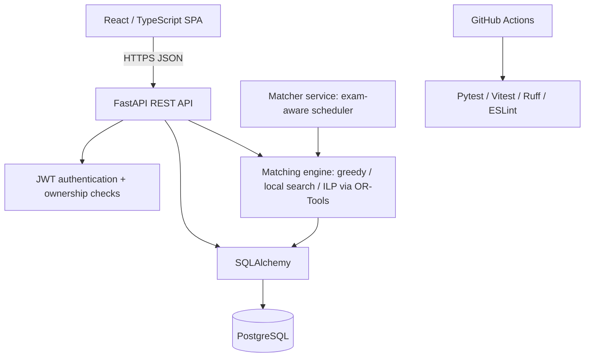

# Architecture

The frontend is a Vite SPA; in Docker development, Vite proxies `/api` to the backend. FastAPI uses dependency-injected SQLAlchemy sessions. Passwords are Argon2-hashed and JWTs are time-limited. Group creation automatically enrolls the owner. PostgreSQL row locks protect capacity checks and FIFO waitlist promotion during concurrent joins; per-course advisory locks serialize matching between the API and the scheduler. See [matching.md](matching.md).

## Tradeoffs
- REST vs GraphQL: simpler API contracts and debugging for MVP.
- PostgreSQL vs document DB: referential integrity for membership relationships.
- Sessions: signed tokens in HttpOnly, Secure, SameSite=Lax cookies, so page scripts can't read them. Cookie-authenticated writes need a double-submit CSRF token. Bearer tokens remain available for API clients. There's no server-side revocation yet: tokens expire after 7 days.
- Sign-up rules are configuration: open to anyone by default, or restricted to school domains (`upenn.edu` and its subdomains) with an emailed, purpose-scoped confirmation token before first sign-in. With verification on, usage numbers only count confirmed accounts.
- Rate limiting: in-memory sliding windows, per account for sign-in and resend and generous per IP, because campus NAT puts many students behind one address. Per instance only.
- Deployment: one image serves the built React app from FastAPI, so the API and UI share an origin. The matcher can run in-process for hosts without background workers.
- Courses are seed-managed rather than user-created, keeping scope manageable.
- Matching optimizes over a generated candidate pool (set partitioning) rather than a compact pairwise ILP: it captures true group-wide schedule intersection and stays tractable for a few hundred students per course, at the cost of optimality only over the pool.
- Matching runs synchronously inside the request for instant fills and rematches (cheap insertions); full rounds run in the separate matcher process.
- No resource uploads, notifications or calendar import yet. Students enter availability on a weekly grid.
