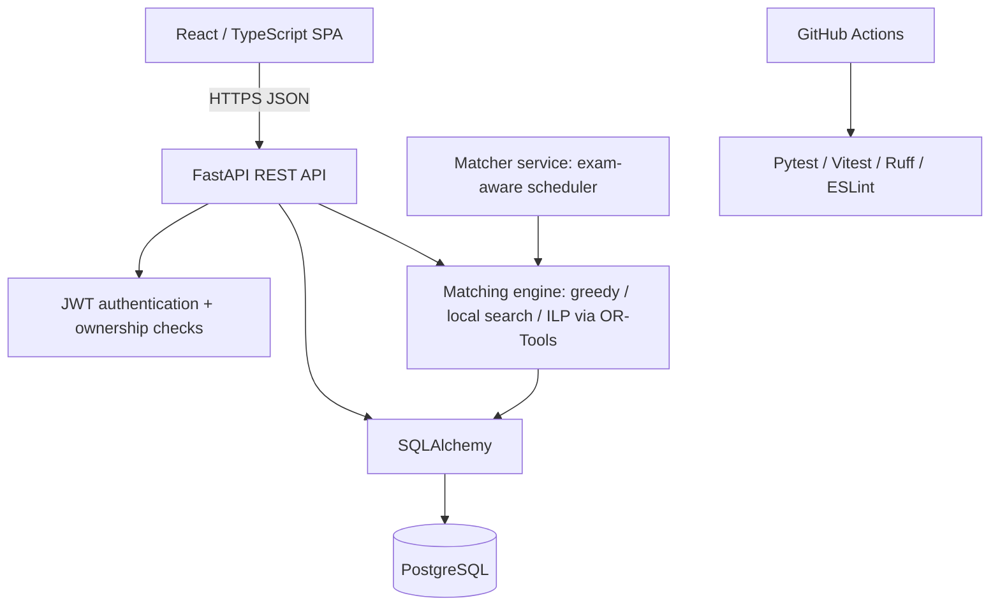

# Architecture

The frontend is a Vite SPA; in Docker development, Vite proxies `/api` to the backend. FastAPI uses dependency-injected SQLAlchemy sessions. Passwords are Argon2-hashed and JWTs are time-limited. Group creation automatically enrolls the owner. PostgreSQL row locks protect capacity checks and FIFO waitlist promotion during concurrent joins; per-course advisory locks serialize matching between the API and the scheduler. See [matching.md](matching.md).

## Tradeoffs
- REST vs GraphQL: simpler API contracts and debugging for MVP.
- PostgreSQL vs document DB: referential integrity for membership relationships.
- JWT in sessionStorage: simple portfolio implementation, but vulnerable to token theft if XSS occurs. Production deployment should prefer HttpOnly Secure SameSite cookies with CSRF protection or a managed identity provider, rate limiting, refresh/revocation, and email verification.
- Courses are seed-managed rather than user-created, keeping scope manageable.
- Matching optimizes over a generated candidate pool (set partitioning) rather than a compact pairwise ILP: it captures true group-wide schedule intersection and stays tractable for a few hundred students per course, at the cost of optimality only over the pool.
- Matching runs synchronously inside the request for instant fills and rematches (cheap insertions); full rounds run in the separate matcher process.
- No resource uploads, notifications or calendar import yet. Students enter availability on a weekly grid.
