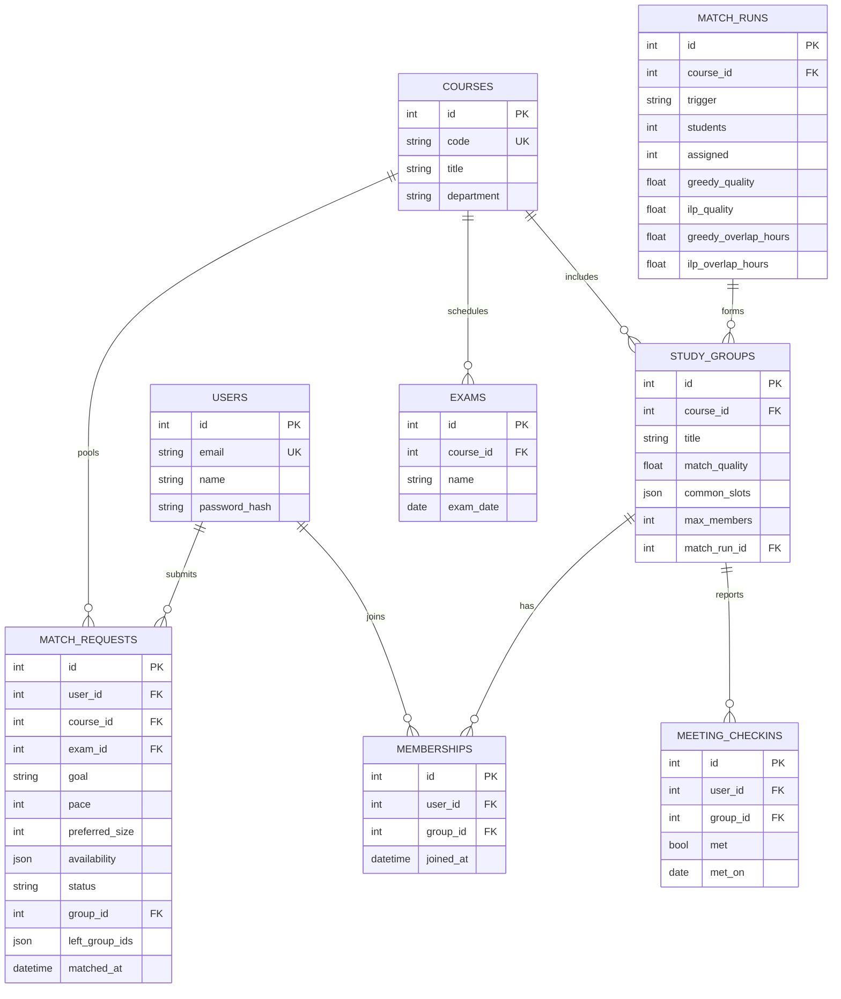

# Data model

`memberships` has a unique constraint on `(user_id, group_id)`; `study_groups.max_members` has a database CHECK >= 2.

All groups are formed by the matcher. They have no owner, any member may leave, and only members (and admins) can see them. Migration 004 removed student-created groups and the old `waitlist_entries` table; the unused `owner_id` and `kind` columns remain for compatibility. `meeting_checkins` is unique on `(user_id, group_id, met_on)`: a group "met" on a date if any member reported `met = true` for it.
